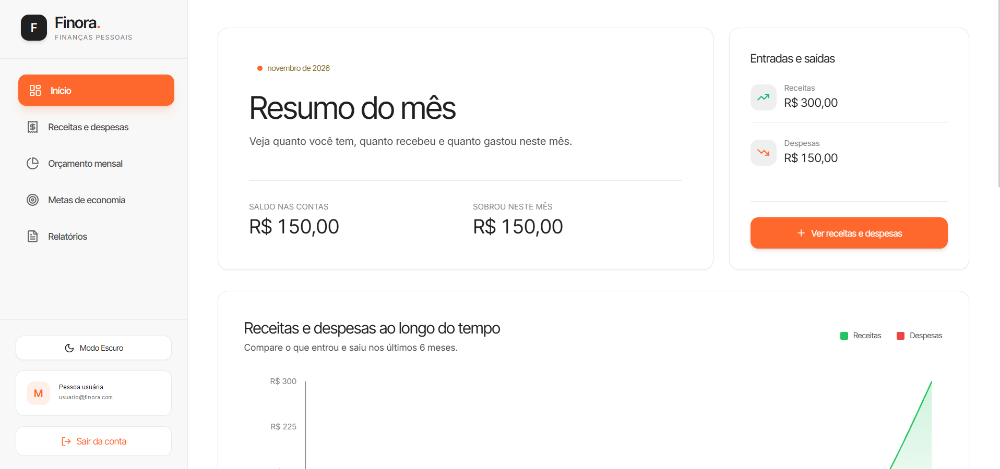
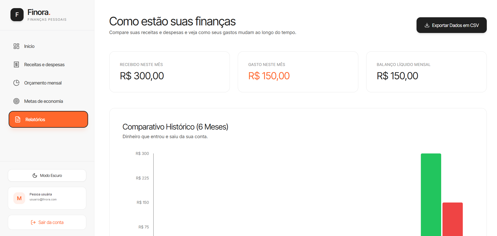

# Finora — Finanças pessoais

O **Finora** é uma aplicação web para organizar receitas, despesas, orçamentos e metas financeiras em um só lugar. A proposta é tornar o acompanhamento do dinheiro simples de entender, com um painel visual e relatórios objetivos.

## Telas do sistema

<div align="center">
  
  
</div>

*As informações de perfil foram anonimizadas nas imagens. Os valores exibidos são demonstrativos.*

## Funcionalidades

- Cadastro com e-mail e senha e entrada automática na primeira sessão.
- Login para voltar à conta e consultar os dados já salvos.
- Registro e organização de receitas e despesas por categoria e conta.
- Painel com saldo, resumo mensal e evolução financeira.
- Orçamentos mensais por categoria.
- Metas de economia com acompanhamento de aportes.
- Relatórios e comparativo histórico, com exportação de dados em CSV.
- Tema claro e escuro.
- Persistência por usuário em PostgreSQL.

## Tecnologias

| Área | Tecnologias |
| --- | --- |
| Interface | React, TypeScript, Vite e Tailwind CSS |
| Gráficos | Recharts |
| API | Node.js, Express e TypeScript |
| Banco de dados | PostgreSQL e Prisma |
| Autenticação | Cookie HttpOnly com JWT e senhas protegidas com bcrypt |

## Executar localmente

Você precisa ter **Node.js** e **npm**. O desenvolvimento local usa SQLite; no deploy, a Vercel usa PostgreSQL persistente.

### 1. Configurar o backend

Abra um terminal na pasta do projeto e rode:

```powershell
cd backend
npm ci
Copy-Item .env.example .env
```

Para desenvolvimento local, deixe `DATABASE_URL="file:./dev.db"` e configure `JWT_SECRET` com um segredo aleatório de pelo menos 32 caracteres. Depois rode:

```powershell
npm run prisma:generate
npm run prisma:dev
npm run dev
```

Deixe esse terminal aberto enquanto usa o Finora.

### 2. Iniciar a interface

Abra um segundo terminal na pasta do projeto:

```powershell
cd frontend
npm ci
npm run dev
```

Abra no navegador o endereço mostrado pelo Vite, normalmente `http://localhost:3000`, e crie sua conta.

## Publicar na Vercel

O projeto inclui configuração de build, API e migrations. Para conectar o banco e publicar, siga o [guia de deploy na Vercel](DEPLOY-VERCEL.md).

## Imagens

- Painel: [`docs/dashboard.png`](docs/dashboard.png)
- Relatórios: [`docs/reports.png`](docs/reports.png)
